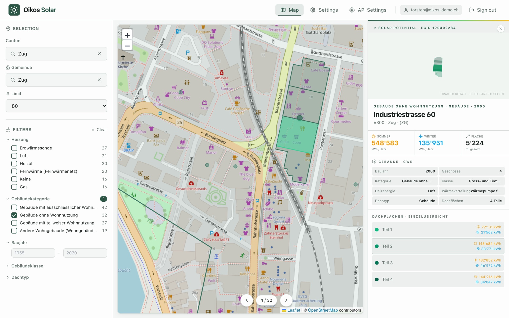
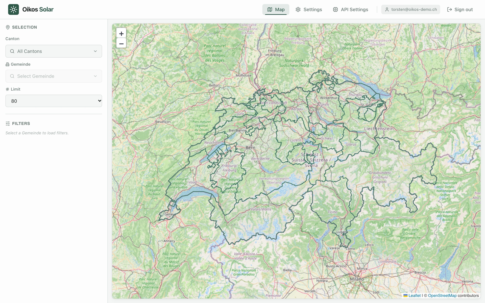
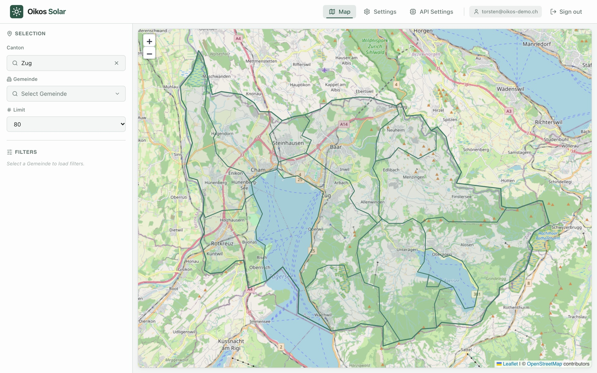
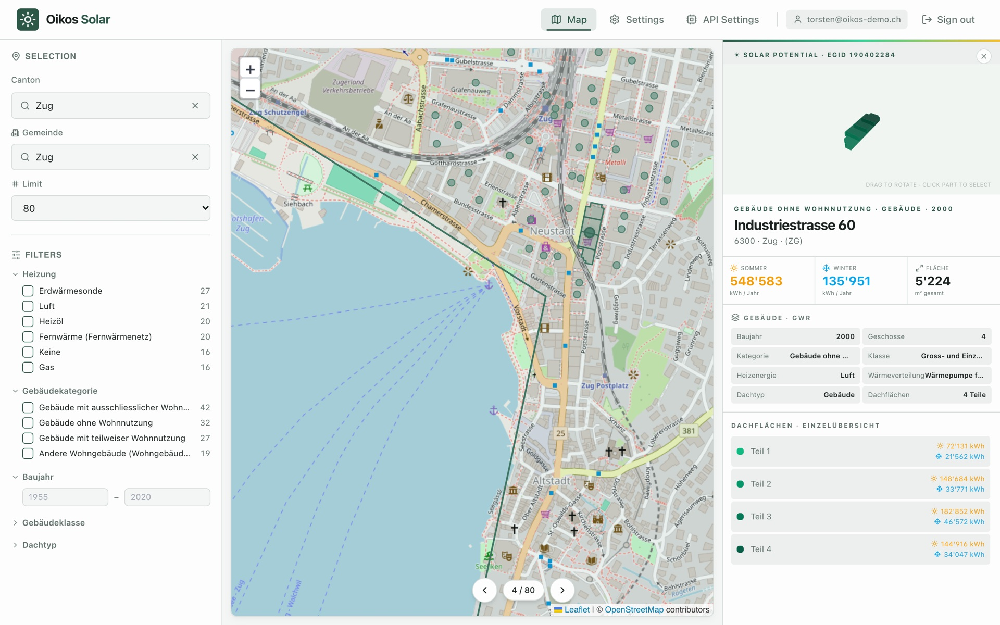
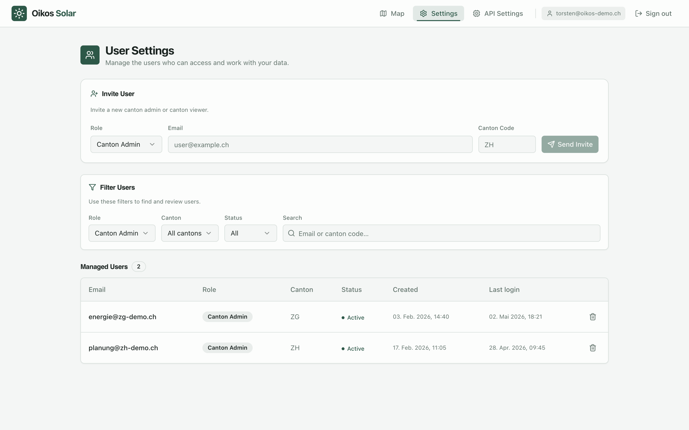
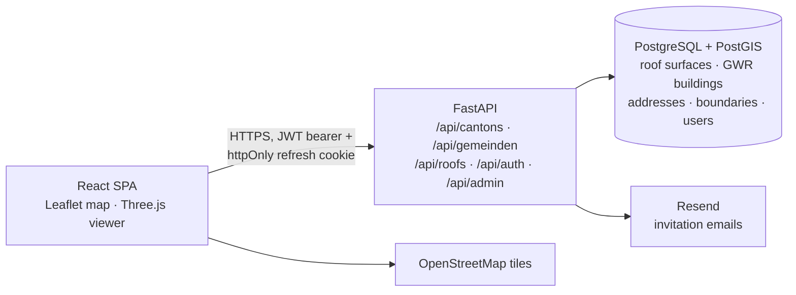
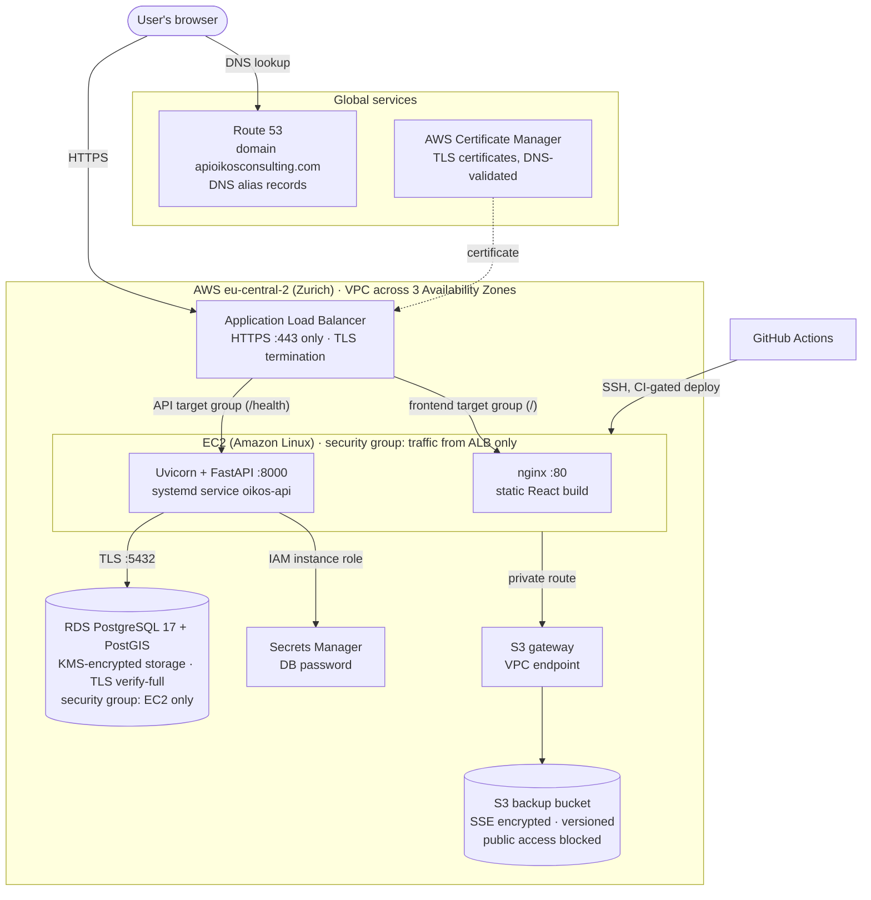

# Oikos Solar

[](https://github.com/torstenschmaelzle/oikos-vision/actions/workflows/ci.yml)
[](LICENSE)

**Find the Swiss rooftops with the highest solar potential, down to the individual roof surface.**

Oikos Solar is a map-based web platform for cantonal energy offices, municipalities and solar installers. It combines the federal roof-solar dataset (*Sonnendach / SOLKAT*) with the Swiss building register (*GWR*) and official boundaries, so a user can pick a canton and municipality, filter buildings by type, age, size or heating system, and immediately see which roofs offer the most energy, and how each roof surface contributes.



---

## Mission

Switzerland publishes excellent open data about solar energy: for every roof in the country, the federal government has calculated how much electricity a PV system could produce. But the data is hard to use. It is spread over several datasets, each several gigabytes in size, in Swiss coordinate systems and with coded attributes. Answering a simple question such as *"Which non-residential buildings in this municipality have the best roofs for solar, and how are they heated?"* takes GIS software and a good deal of data wrangling.

**Oikos Solar makes this data available and easy to search.** It joins the sources into one database, puts it behind a fast API, and offers a map interface where anyone can go from the whole country to one roof surface in a few clicks, without GIS knowledge. The goal is to help cantons, municipalities and installers find the roofs where solar pays off most, and so speed up the solar build-out.

---

## Data

All data comes from official Swiss open government sources and was merged into one PostgreSQL/PostGIS database:

| Dataset | Publisher | What it contributes |
|---|---|---|
| **[Sonnendach.ch / SOLKAT](https://www.uvek-gis.admin.ch/BFE/sonnendach/)** (solar suitability of roofs) | Swiss Federal Office of Energy (SFOE) | ~10 million roof surfaces as polygons, each with area, orientation, slope, suitability class and the estimated PV yield for the summer and winter half-year, linked to a building ID (EGID) |
| **[GWR](https://www.housing-stat.ch/)** (Federal Register of Buildings and Dwellings) | Federal Statistical Office (FSO) | Building attributes per EGID: category and class, year of construction, number of floors, heating energy source and heat generator |
| **[Official building addresses](https://www.swisstopo.admin.ch/en/official-directory-of-building-addresses)** | swisstopo | Street, house number, postcode and municipality for each EGID, plus a point location for the map markers |
| **[swissBOUNDARIES3D](https://www.swisstopo.admin.ch/en/landscape-model-swissboundaries3d)** | swisstopo | Official canton and municipality boundaries (assigning roofs to regions and drawing the map) |
| **[OpenStreetMap](https://www.openstreetmap.org/copyright)** | OSM contributors | Background map tiles |

Roof surfaces are aggregated per building (total summer/winter yield, total and union roof area). GWR codes are translated into readable labels and offered as search filters.

---

## My role

Solo project: I designed and built the whole platform.

- **Data engineering:** imported and joined SOLKAT roof surfaces, GWR building attributes and swissBOUNDARIES3D boundaries in PostgreSQL/PostGIS (~10 million roof surfaces), assigning every roof surface to its building, municipality and canton.
- **Backend:** FastAPI service with GeoJSON endpoints, server-side GWR filtering, JWT auth with refresh-token rotation, role-based access, email invitations and an admin log/test-runner API. One query rewrite brought the filter-options endpoint from **~60 s to 94 ms**.
- **Frontend:** React/TypeScript app. I generated the initial UI scaffold with [Lovable](https://lovable.dev) and then built the core features myself: interactive Leaflet map navigation, GWR filters, the roof detail panel, the Three.js 3D roof viewer and roof-part selection synced between map and 3D view.
- **Infrastructure:** AWS (EC2, RDS, Secrets Manager), nginx, systemd, and GitHub Actions deploys for frontend and backend.

---

## Features

| | |
|---|---|
| **Drill-down map** | Switzerland → canton → municipality → building, with smooth fly-to transitions and hover tooltips (Leaflet + OpenStreetMap). |
| **Ranked roofs** | Buildings in a municipality are ranked by annual summer yield; the best roof is selected automatically, and arrow buttons step through the ranking. |
| **Roof detail panel** | Summer/winter yield (kWh/year), roof area, GWR attributes (year built, floors, category, class, heating source) and a list of each roof surface. |
| **3D roof viewer** | Three.js model of the extruded roof surfaces; drag to rotate, click a surface to highlight it on both the 3D model and the map. |
| **GWR filters** | Server-side filtering by building category, building class, heating energy source, object type, construction year and number of floors, with live counts per option. |
| **Accounts & roles** | `superadmin`, `canton_admin` and `canton_viewer` roles; invite-only onboarding by email; canton admins manage the users of their own canton. |
| **Admin tooling** | Log viewer for app/auth/error logs and a button that runs the backend test suite on the server and shows the results. |

<table>
  <tr>
    <td></td>
    <td></td>
  </tr>
  <tr>
    <td align="center"><em>Start: all 26 cantons</em></td>
    <td align="center"><em>Canton selected: its municipalities</em></td>
  </tr>
  <tr>
    <td></td>
    <td></td>
  </tr>
  <tr>
    <td align="center"><em>Municipality: ranked buildings and filters</em></td>
    <td align="center"><em>Invite-only user management</em></td>
  </tr>
</table>

---

## Tech stack

| Layer | Technologies |
|---|---|
| **Frontend** | React 18, TypeScript, Vite, Tailwind CSS, shadcn/ui (Radix UI), TanStack Query, React Router |
| **Maps & 3D** | Leaflet (GeoJSON layers, OpenStreetMap tiles), Three.js (extruded 3D roof model with raycast selection), Framer Motion |
| **Backend** | Python, FastAPI, Uvicorn, psycopg2 (connection pool), Pydantic |
| **Database & GIS** | PostgreSQL + PostGIS (spatial joins, `ST_SimplifyPreserveTopology`, `ST_Transform` from LV95 to WGS84, GeoJSON output) |
| **Auth & security** | JWT access tokens (python-jose), rotating refresh tokens in httpOnly cookies, bcrypt password hashing, role-based access, AWS Secrets Manager for DB credentials |
| **Email** | Resend (invitation emails) |
| **Infrastructure** | AWS EC2, RDS and Secrets Manager, nginx, systemd |
| **CI/CD** | GitHub Actions: tests and build on every push and pull request; manual deploys that rerun CI, ship the exact tested commit and roll back the backend if its health check fails |
| **Testing** | Vitest + Testing Library (frontend), pytest integration tests (backend) |

---

## Architecture



The hosting setup on AWS is described in the next section.

**How a request flows**

1. On load, the SPA silently refreshes its session (httpOnly refresh cookie → short-lived access token kept in memory only).
2. Choosing a canton or municipality fetches simplified GeoJSON boundaries; geometry is simplified server-side (PostGIS) with a different tolerance per map level, which keeps payloads small.
3. `/api/roofs/top` returns the highest-yield buildings of a municipality, filtered server-side by the GWR query parameters.
4. Selecting a building loads its individual roof surfaces (`/api/roofs/building/{egid}`), which are drawn on the map and extruded in the 3D viewer.

---

## AWS infrastructure

I set up and ran the production environment on AWS myself. It went through two stages. The final setup ran in the **Zurich region (`eu-central-2`)** so that the data and the application stayed in Switzerland. The environment has since been shut down; encrypted database snapshots were kept.



**Networking and traffic**

- **Domain and DNS:** I registered the domain `apioikosconsulting.com` through Route 53. Alias records point `data.` (API) and `www.` (web app) at the load balancer.
- **HTTPS:** TLS certificates from AWS Certificate Manager, validated through DNS records in Route 53. The Application Load Balancer listens only on port 443 and terminates TLS. Plain HTTP is never exposed to the internet.
- **Load balancing:** The ALB spans several Availability Zones and forwards requests to two target groups: nginx serving the React build (port 80) and the FastAPI service (port 8000). Each target group has its own health check.

**Security**

- **Security groups as layers:** Only the ALB accepts traffic from the internet (443). The EC2 instance accepts web and API traffic only from the ALB's security group, and SSH only from a single admin IP. The database accepts port 5432 only from the application's security group.
- **No credentials in code:** The EC2 instance uses an IAM instance role to read the database password from Secrets Manager at startup, so no AWS keys are stored on the server. Application secrets live in an environment file on the server, never in the repository.
- **Encryption at rest:** RDS storage, database snapshots and S3 buckets are encrypted (KMS / SSE). The backup bucket is versioned and blocks all public access.
- **Encryption in transit:** HTTPS from the browser to the ALB. The API connects to PostgreSQL with `sslmode=verify-full` against the Amazon RDS CA bundle. Refresh tokens are sent only as `httpOnly`, `Secure` cookies.
- **Private S3 access:** An S3 gateway endpoint keeps traffic between the VPC and S3 on the AWS network.

**Data and operations**

- **Database:** Amazon RDS for PostgreSQL 17 with PostGIS (about 80 GB) holds ~10 million roof surfaces plus buildings, addresses, boundaries and user accounts.
- **Data loading:** The raw government datasets were uploaded to S3 and loaded into RDS by a Python pipeline (validation, unzipping, spatial joins).
- **Processes:** nginx and the API run as systemd services. The API writes rotating app, auth and error logs, which admins can read in the web app.
- **Backups and migration:** Manual, encrypted RDS snapshots. I used them to move the database from the first region to Zurich and to keep a final copy when the environment was shut down.

**First stage: Stockholm (`eu-north-1`)**

The first version used a different design. The React build sat in a private S3 bucket that only CloudFront could read (Origin Access Control). A CloudFront distribution protected by AWS WAF served the app and forwarded `/api/*` to the EC2 instance. The RDS database ran in three dedicated private subnets: their route table had no route to the internet, so the database could only be reached from inside the VPC. The move to Zurich replaced CloudFront with the Application Load Balancer and the custom domain.

---

## Getting started

### Prerequisites

- Node.js 18+ and npm
- Python 3.10+ (backend only)
- PostgreSQL with PostGIS containing the imported SOLKAT, GWR and boundary data (backend only)

### Frontend

```bash
cd frontend
npm install
npm run dev        # http://localhost:8080
```

```bash
npm test           # unit and component tests (Vitest)
npm run build      # production build into dist/
```

> The API base URL is set in `frontend/src/lib/api.ts`. Since the hosted API is offline, point it to your own backend to see live data.

### Backend

```bash
cd backend
python -m venv venv && source venv/bin/activate
pip install -r requirements.txt
cp .env.example .env   # fill in your values, then export them
uvicorn main:app --reload --port 8000
```

All configuration is read from environment variables (see [`backend/.env.example`](backend/.env.example)); database credentials are fetched from AWS Secrets Manager at startup. The tests in `backend/tests/` are integration tests: they run against a live server on `127.0.0.1:8000` with a populated database.

---

## Project structure

```
.
├── frontend/
│   ├── src/
│   │   ├── pages/            # Map, Settings, API settings, Login, Setup account
│   │   ├── components/
│   │   │   ├── map/          # MapView, FiltersPanel, RoofDetailPanel, RoofViewer3D, …
│   │   │   ├── settings/     # user invitation and management
│   │   │   ├── admin/        # log viewer, test runner
│   │   │   ├── auth/         # route guards (ProtectedRoute, RoleGuard, …)
│   │   │   └── ui/           # shadcn/ui primitives
│   │   ├── hooks/            # useMapState: selection, filters, data loading
│   │   ├── lib/              # API client, auth context, roles, types
│   │   └── test/             # Vitest unit and component tests
│   └── package.json
├── backend/
│   ├── main.py               # FastAPI app, request logging middleware
│   ├── routers/              # cantons, gemeinden, roofs, auth, admin, tests, crawler
│   ├── services/             # auth, email, geo helpers, GWR labels, test runner
│   ├── migrations/           # SQL migrations
│   ├── tests/                # pytest integration tests
│   └── requirements.txt
├── docs/screenshots/
└── .github/workflows/        # CI (tests, build) + manual, CI-gated deploys to EC2
```

---

## License

[MIT](LICENSE) © Torsten Schmälzle
