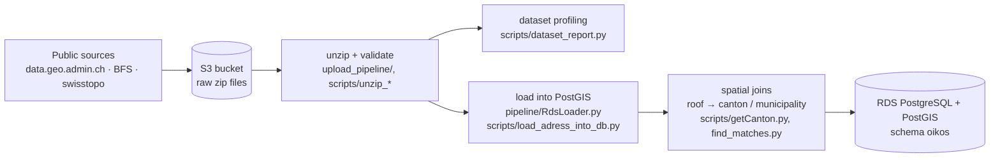

# Data pipeline

The scripts that turned the public Swiss open-government datasets into the PostGIS database behind Oikos Solar. They were written between October 2025 and March 2026 and ran on the EC2 instance next to the database. They were added to this repository later. Credentials are always read from environment variables or AWS Secrets Manager.

## Flow



## Contents

| Path | Purpose |
|---|---|
| `upload_pipeline/` | Downloads source archives, stores them in S3 and extracts them (`S3ObjectStore`, `ZipExtractor`). |
| `pipeline/` | Generic loader: a `DatasetSpec` describes the tables and columns of a GeoPackage, and `RdsLoader` copies them into PostGIS, checking existing tables and columns first. Used for the roof (SOLKAT) and facade datasets. |
| `scripts/upload_data_into_S3_bucket.py` | Streams a dataset (e.g. swissBOUNDARIES3D) from the federal geodata portal straight into S3. |
| `scripts/dataset_report.py` | Profiles a GeoPackage or CSV (layers, row counts, columns, CRS, bounding box) and writes the reports in `reports/`. |
| `scripts/load_adress_into_db.py` | Loads the official building address directory (~3.3 million rows) into `oikos.addresses` and creates the indexes the API relies on. |
| `scripts/getCanton.py`, `scripts/find_matches.py`, `scripts/roofs_by_canton.py` | Spatial joins that assign each roof surface to its canton (swissBOUNDARIES3D) and match roofs to addresses through the building ID (EGID). |
| `scripts/extract_kantone_gemeinden.py`, `scripts/unzip_Swiss_Boundaries.py`, `scripts/fix_s3_backslashes.py` | Helpers for the boundary dataset and for cleaning S3 object keys. |
| `reports/` | Generated profiling reports, e.g. SOLKAT: 10,071,755 roof surfaces, 4.3 GB GeoPackage in LV95 (EPSG:2056). |

## Running

```bash
cd data-pipeline
python -m venv venv && source venv/bin/activate
pip install -r requirements.txt
export AWS_REGION=... PGHOST=... PGUSER=... PGPASSWORD=...   # or OIKOS_DB_SECRET_ID for Secrets Manager
python scripts/dataset_report.py --help
```

Several scripts expect the raw files in a local cache directory (`CACHE_DIR`, default `/home/ec2-user/data/cache`) or in the S3 bucket configured at the top of the script.
